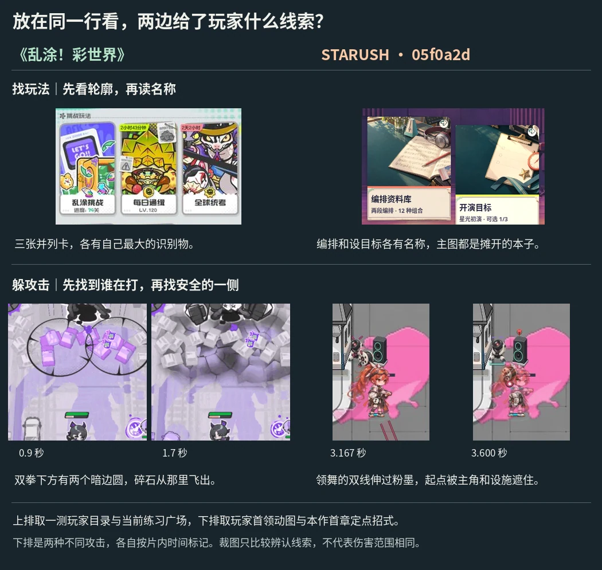

# STARUSH 与《乱涂！彩世界》差距复盘

2026 年 11 月 25 日，检查游戏版本 `05f0a2d`。从选人、开打、落败或首通，一直点到查看装备和下一站。**最影响体验的三件事是同一个角色在不同入口变了人、地面的粉墨盖住来招、玩家要读完文字才知道某个按钮能做什么。** 这些问题即使把按钮画得更精细，玩家仍然会遇到。

上排比较同样用来辨认用途的卡，下排比较两种不同的敌招是否能提前看出作用位置。竞品来源分别为一测玩家的玩法目录（正文第 5 张）和公测前玩家的双拳连续动图。本文把相册第一张称为第 1 张，底稿索引从 0 起算。[一测目录](https://www.taptap.cn/moment/685538921035073313) · [首领实战动图](https://www.taptap.cn/moment/776073343404084700)

## 哪些差距会直接改变玩家的判断

| 模块 | 玩家在当前版本会遇到什么 | 制作时先验哪一件事 |
| --- | --- | --- |
| 人物、剧情、居所 | 蔚蓝魔法师在名册和战斗里戴白帽、拿蓝书。回休息室，她说想试“重锤的落点”；点进居所，站着旧猫耳 Q 版，点头像又是旧重锤手。回到首章，选“宽幅涂染”仍写“重锤覆盖”。这是已能复现的身份错误。 | 用同一存档连走这四处，检查台词、Q 版、立绘、技能说明全都指向当前成员；保留已对上的三人立绘和战斗 Q 版。[四处实画](visual-qa/2026-11-25-gap/systems-residence.webp) |
| 按钮、背景、文本框 | 新号声音设置的返回处只剩一个深紫空方块。首页、服务台两个入口在 320 和 390 宽都复现，四次都能点回去。练习广场的两张卡则是另一类问题：一本表示编排，一本表示设目标，玩家要读字才分得清。压轴入口的模式名还伸出色底约 5 像素。 | 先让关闭符号在两档尺寸都可见，再遮住玩法名称看两张图能否辨用途。文字底板按实际字高验收。不要给整页继续叠花纹。[界面实画](visual-qa/2026-11-25-gap/interface-details.webp) |
| 场上美术、地图 | 390 宽首章，一只轮式追兵约为绿发角色身高的 31%，容易混进灰色店墙。彩世界一则公测后实画里，普通怪约为人物身高的 69%，在灰街上有独立外轮廓。这是各取一个样本。第二章看不出两店怎样给中枢供电，第四章碎纹干扰校音圈，第五章回港虽有新地线，回流方向仍靠看标签。 | 把同一追兵放到店铺阴影、干净路面和已经染色的路面。先试轮廓与动势，再调大小。地图以“能指出哪一家通电、下一处往哪走”验收。[敌人比例](visual-qa/2026-11-25-gap/art.webp) · [五章十景](visual-qa/2026-11-25-gap/arena-maps.webp) |
| 人物动作、敌方动作 | 三人的上行、下行都沿用侧身跑姿，急停直接回待机。每人的攻击图集第 16 和 17 格全图像素相同，收招最后两拍看着定住。发射器有真实的蓄力和开火，机身却主要靠轻微倾斜；一旦与追兵挤在一起，难以认出是谁出手。 | 三位各做“上跑→急停→出招→收势”，暂时隐藏大特效，看能否分出方向和出招。敌人再做一次“准备→实际释放”，遮住预警字也能找到发起者。[三人攻击回放](visual-qa/2026-11-25-gap/motion-contact-loop.webp) · [敌方逐拍](visual-qa/2026-11-25-gap/motion-enemies.webp) |
| 涂色、攻击、受击与安可 | 粉墨会扩散并留下，但密处亮度接近，砖缝和喷涂方向只在部分位置可追。领舞的粉色双线恰好走过粉地和主角脚下；红发打倒追兵的取样里，最抢眼的白勾却在旁边已恢复的音箱上。绿发风刃更能把眼睛带到命中点。安可侧卡实测占战区 6.82%，中央仍可操作，问题集中在侧卡结束时怎样看清清掉了哪些来弹。 | 首章同一路口分别放普通怪、领舞、设施，粉青橙三色都拍。玩家能指出“我在哪、谁打谁、往哪躲”，再验收安可前后地面和来弹的变化。[命中](visual-qa/2026-11-25-gap/arena-contact.webp) · [涂色与安可](visual-qa/2026-11-25-gap/arena-paint-encore.webp) |
| 自动瞄准、追兵与设施 | 同一个南口音箱旁，追兵靠近后，自动瞄准从音箱转到追兵。画面依然引导“南口音箱”，两种自动状态都没有集火标签。实点音箱后才出现“集火 · 南口音箱”，再次点按可取消。玩家能看懂章节目的地，却可能误判下一枪。 | 把章节箭头、当前射击目标、手动指定三种状态同时验收。只改变小范围提示，避免每只敌人头上再叠一块牌。测试目标交错、目标消失和隔墙绕行。[自动选目标的实际条件](visual-qa/2026-11-25-gap/targeting.md) |
| 新手、养成与结算 | 新号第一次能移动之前，读完剧情要点 7 次，跳过也要 4 次。风歌升级从 27 笔记扣到 24，真正增加的是主动涂染威力，付款页只写“涂染增益”。首通两件不同的配件在领奖时都是同一只绿罐，进背包才分成宽口和双管。自然失败的一场受击 6 次，第一条再演建议却只说还差 9 处设施。 | 从一场失败、一场首通分别走到下一场。看玩家能否说出这次为什么输、赢得了哪件、装备后改变哪一招；查看新配件后仍能接续原来的下一站。[首战四屏](visual-qa/2026-11-25-gap/systems-first-run.webp) · [奖励对照](visual-qa/2026-11-25-gap/result-items.webp) · [胜负实画](visual-qa/2026-11-25-gap/result-outcomes.webp) |
| 手机屏幕和弹层 | 390×844 的首页填满手机，战场和暂停都变为 390×694，上下各有约 75 像素暗边；430×932 上约 84 像素。小手机上几乎没有这个落差，平板则是左右宽度改变。单看一张首页或一张战斗图很容易漏掉。 | 同机从主页连录到首发子弹。先试让余下的区域承接场馆的背景或状态，再复查手指位置、危险出现时机与安全区。[五档实测](visual-qa/2026-11-25-gap/viewport.md) |

## 各模块怎么查

| 想核对的内容 | 覆盖范围 |
| --- | --- |
| [产品与玩法逐项表](visual-qa/2026-11-25-gap/systems.md) | 全部 25 个登记模块。22 个有运行内容，3 个规划项是账号云存档、社交联机、平台服务。逐项标了有直接参照、只作类比或只能按本作规则检查。包括场馆、资料库、相处记录、存档、企划与解锁条件。 |
| [逐页、逐窗](visual-qa/2026-11-25-gap/interfaces.md) | 21 页各一行，40 个二级入口逐一编号。另有启动、横屏、战斗 HUD、暂停、安可、编排及不同模式的结算。独立居所另在产品表实走。 |
| [美术](visual-qa/2026-11-25-gap/art.md) · [动作](visual-qa/2026-11-25-gap/motion.md) | 立绘与 Q 版、武器和墨色、普通怪的大小与轮廓、首尾姿势。三位出战角色分别看方向、起停、普攻、主动、受伤和倒地；六类敌方对象有现场样本。 |
| [五章地图与战斗特效](visual-qa/2026-11-25-gap/arena.md) · [自动选目标与追兵](visual-qa/2026-11-25-gap/targeting.md) | 每章各取入场和北区一个点。另分看落色、异色接触、命中、警示、首领、安可，以及手动指定目标后玩家可以看到的反馈。 |
| [自然失败、领奖与返回](visual-qa/2026-11-25-gap/settlement.md) · [五档画面边界](visual-qa/2026-11-25-gap/viewport.md) | 320 与 390 两档走结算分支，再从奖励追到背包；首页、战斗、暂停三处边界另在五档同路线量取。 |
| [竞品连续画面与时间码](visual-qa/2026-11-25-gap/reference.md) | 两篇玩家首领动图、六月和十一月两条官方赛季短片，六组时段。静态界面取一测相册；公测后的敌人大小另有五月第三方实画。[公测后战场来源](https://game.xiaomi.com/viewpoint/1674478871_1778044433330_100) |

## 下一轮先做到哪一步

先修四处旧角色和声音设置的空按钮，都有明确的正确结果，修后可以沿原路径逐个复验。随后只取首章街口的一小段：同屏放角色、一只轮式追兵、一个会预警的领舞和一台可恢复的音箱。录下走近、急停、自动开火、命中、躲避、设施亮起。分别在 320、390、430 宽回放，先请首次看到画面的人指出敌人、落点和安全方向，再判断颜料厚度与粒子多少。这个样板通过后，再把相同的辨认标准用于其余四章和另外两位角色。

本轮是差距审查。已有单底栏、三名正式战斗角色和局部安可小窗可以沿用。有关首通的画面用了游戏自己的胜利事件，五章资料用测试档解锁；390 宽首章另有一次自然失败。未在实体手机上量帧率、触感或耗电，也未完整手打五章。负责人教程本轮用到 v03、v08、v16 的抽样画面，完整课程和音轨未能复核。竞品动图可以验证视觉次序，不能用来推断它的判定代码、AI 权重或输入延迟。[教程读取记录](TUTORIAL_REFERENCE_STATUS.md)
