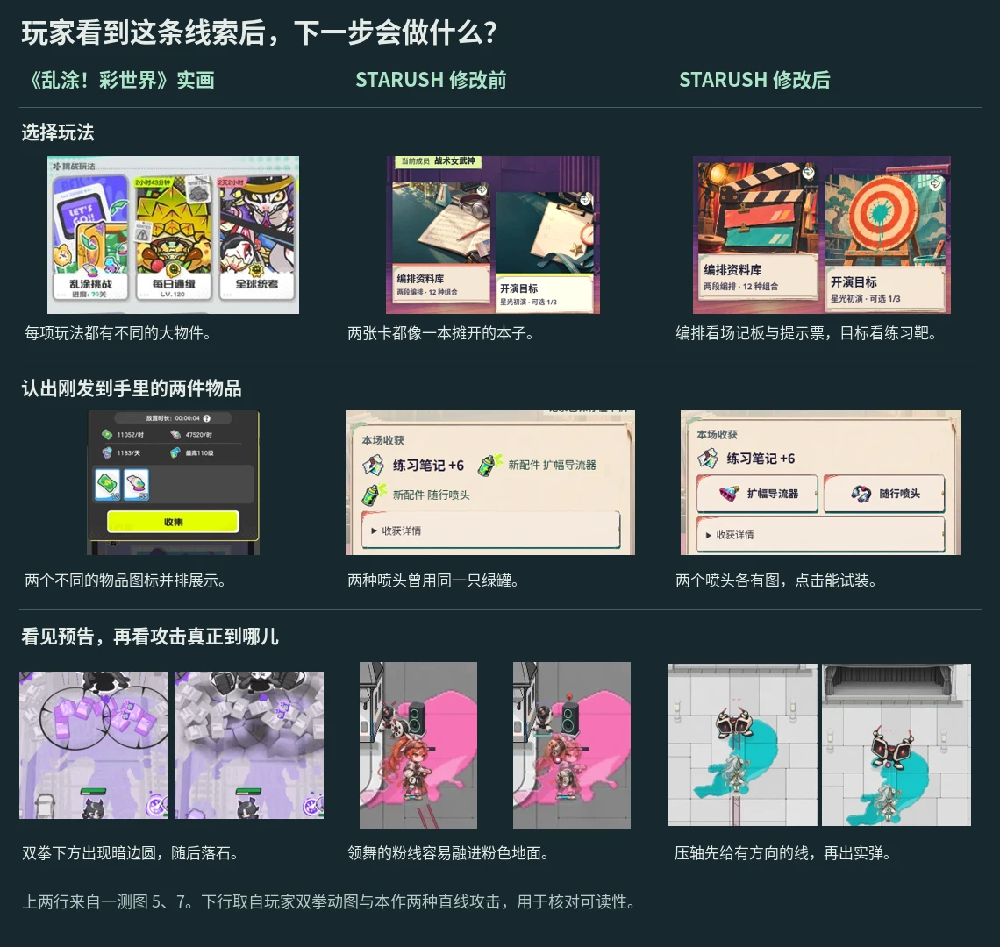

# STARUSH 改版后的全模块复查

11 月 25 日，用正式运行工程逐项修改上轮问题，再用《乱涂！彩世界》的同类场景回看。成品内容版本为 `31c4342`。两张练习卡现在分别画出舞台场记板和颜料飞溅的立靶；首通两件不同喷头在结算就能认出来；敌方来招有方向标记，我方命中则亮在实际被打到的位置。[上一轮问题和版本](COMPETITOR_GAP_AUDIT_2026-11-25.md)

两排菜单参考玩家一测图解的图 5、7。下排分别是《彩世界》双拳落地、本作改前的领舞、本作改后的压轴直线招，比较的是看懂落点的方法。首章领舞在三种地面上的同招复测另有连续画面。[一测图解](https://www.taptap.cn/moment/685538921035073313) · [双拳实战动图](https://www.taptap.cn/moment/776073343404084700) · [本作危险线实测](visual-qa/2026-11-25-gapfix/combat.md)

另将首页、选站和成员页分别与图解第 1、14、37 张并排，查看人物周围的入口密度、地图节点、试览与确认按钮的位置。[三组整页实屏](visual-qa/2026-11-25-gapfix/menu-comparison.webp)

## 上轮发现的问题，这一版如何验证

| 模块 | 玩家现在能看到、能做到的事 | 修改后复核 |
| --- | --- | --- |
| 按钮、背景、文本框、层级 | 首页把章节进度放到开演票上，四个一级页各用一条底栏。编排画成场灯下的场记板和提示票，设目标画成立式颜料靶。空记录、锁章、角色资料、七件配件各按自己的用途排版。首页和服务台的声音窗有清楚的关闭符号。 | 新号与五章档各读 21 页。原有 40 窗逐项核对，新增的备战编排和故事也纳入控件实点。320 宽曾有“章节档案”中心落到首章卡的问题，已在同一位置点进正确页面。[21 页与逐窗表](visual-qa/2026-11-25-gapfix/interfaces.md) · [设备结果](visual-qa/2026-11-25-gapfix/devices.md) |
| 正式人物、场内 Q 版、剧情、居所 | 三人的发饰、衣服、武器、墨色和台词沿用负责人确认的人设。女武神用枪，风歌用铃，蔚蓝用书。居所会跟随所选同伴，能问候、小憩、看全身立绘再回到原成员。胜利与失败各有该角色的画。 | 沿名册、休息室、实际三维居所、剧情和局内编排复查。三人各取胜、负两种结算图；历史存档继续沿用原有角色 ID。[三人各入口实画](visual-qa/2026-11-25-gapfix/identity.md) |
| 角色动作与追兵辨识 | 三人上跑、下跑、急停、出招和收招有不同姿势。女武神可朝侧方开枪同时向上、向下迈步，三连发在每一拍从实际枪尖发出。追兵有眼、红鞋和卷盘，发射器、灯罩、干扰器和首领的开合各随真实事件变化。 | 三人从实战取前后帧，倒地走游戏死亡入口。320 宽以减少动态设置点三连发，枪尖分别在第 17、100、200 毫秒出现反馈。短促出弹在低帧时也能看到一次。[逐拍比较](visual-qa/2026-11-25-gapfix/motion.md) · [纵向走、侧向射](visual-qa/2026-11-25-gapfix/rifle-stride.webp) |
| 地图、地块涂色与设施 | 首章唱片灯箱和装卸门各有标记。霓虹街能顺电线看到两家店是否都已供电。港边帆灯一单一双，屋顶校音显示中断和备用供电，回港地线标明回流方向。相邻的异色笔触、路面接缝在染色后仍看得见。 | 五章在 320、390、430 宽共 15 次进场、78 次状态采样。另用方向键走过唱片店侧巷，在装卸门前实点开门。同一路口分次压下粉、青两色检查旧色留存。屋顶同一区域的细碎明暗差，灰地从 7.43 降至 1.41，着色后从 6.11 降至 1.01，测法见地图报告。[五章改前改后](visual-qa/2026-11-25-gapfix/maps.md) · [持续涂色](visual-qa/2026-11-25-gapfix/street-ink.webp) |
| 攻击、命中、危险与安可 | 真正被打到的怪身上出现亮点；子弹打在墙上只在墙面留下擦痕。敌方危险线有深浅边和方向。安可保留侧卡，每次清掉的弹在原位置留下收束痕迹。 | 三位角色分别打一近一远两只怪，首次攻击只伤近敌，远敌血量均保持 36。粉、青、橙地逐一拍预警、发弹、恢复。安可清弹 0、1、3 枚分别验证，390 宽时侧卡占战区 6.82%，中央可操作。[攻击、清弹与竞品逐段对照](visual-qa/2026-11-25-gapfix/combat.md) |
| 自动瞄准、手动集火、追击 AI | 章节箭头指去哪儿，目标脚边的短提示指出下一枪打谁。实点设施可指定，再点可取消。追兵遇到遮挡会沿可走处追，失去有效玩家时会停。 | 两敌轮流被墙遮挡：瞄甲、改瞄乙、无目标、重新瞄甲。另引同一只追兵绕两角，224 次更新内走过的身体范围均未穿墙，最后追到玩家。竞品公开视频没有公开仇恨与寻路算法。[目标切换与轨迹图](visual-qa/2026-11-25-gapfix/pursuit.md) |
| 新手、训练、奖励与连续游玩 | 首次两次点击就能开打，想看故事可在备战阅读。付费训练前能看清实际增加哪一项。首通两件装备当场分别查看、装备，回到原结算接下一站。生命耗尽、场地超时、压轴超时分别提示；三站连演题头显示进度和继承生命。 | 实付 3 笔记让风歌主动涂染从 0 升至 +10%。320 和 390 宽分别从三种败因重试、首通、来回换装、继续第二章；换装前后均为 1 次通关、4 次登记对局。测试用真实结束入口和计时器定位结果。[25 模块逐项表](visual-qa/2026-11-25-gapfix/product.md) · [八幅战内小窗](visual-qa/2026-11-25-gapfix/battle-overlays.webp) |
| 长屏、暂停、启动及本场编排 | 多出的屏幕空间接续本章场馆图。暂停的继续键上方显示当前目标和剩余设施。编排选中后在卡片旁看变化；实际接通设施时原有计数短暂放大。启动失败时可见的重试键获得键盘焦点。 | 390 宽的战区仍是 390×694，位置和输入比例保持一致，原来上下约 75 像素暗边已有画面。启动中断后按 Enter 重试，再横屏转回竖屏，能继续点进背包。320 实战接通时计数 1/10→2/10，小幅强调 420 毫秒。[同机三屏](visual-qa/2026-11-25-gapfix/viewport.webp) |

## 复看时还能看出的差距

- 第一版改后，两张练习卡只有很小的场记板和靶环。放到竞品旁边看后，二次补画了舞台灯下的编排现场与颜料靶台。竞品同一行的三张卡都用人物剪影招呼玩家，本作这两张用大物件和场景区分操作。320、390 宽分别点图进入编排和目标，配件资料保留具体数值、归属与轨迹。[玩法与收获对照图](visual-qa/2026-11-25-gapfix/compare-after.webp)
- 普通追兵原实画约为风歌身高的 31%。在同一显示比例下，用新图格换算约为 58%–62%，再让追兵走过灰路、墨边和店前检查轮廓。竞品公测后一张实画约为 69%。这是各取一种敌人的样本，不能代表两款游戏全部怪物的比例。[追兵三种背景](visual-qa/2026-11-25-gapfix/runner-visibility.webp) · [竞品公测后实画](https://game.xiaomi.com/viewpoint/1674478871_1778044433330_100)
- 安可按本作要求留在画面一侧，保留中央走位。与《彩世界》商店短片约 76.3 秒的技能转场相比，本作更依赖原地清弹和回到角色脚边后能读到什么。公开短片可对照层次与顺序，无法由此测出对手输入延迟和出招帧数。[商店短片与时间段](visual-qa/2026-11-25-gap/reference.md) · [三种清弹数量](visual-qa/2026-11-25-gapfix/encore-clear.webp)

## 成品出包

从内容提交 `31c4342` 重新构建。主游戏 835 项、独立居所 29 项，共 864 项发布资源逐文件核对。用正式静态包走五组触屏会话，分别点过两张练习卡，再选人、开演、释放特技、打开暂停设置和恢复。三位成员全部覆盖，其中两组开启减少动态。页面异常、HTTP 错误、控制台错误和失败请求均为 0。[成品验证与构建信息](visual-qa/2026-11-25-gapfix/release.md)

## 验收边界

登记的 25 个模块中，22 个已有运行实现；账号云存档、社交联机、平台服务三项属于规划，只复核了界面是否如实表达接入状态。六组菜单样本共 1,729 次控件检查，覆盖四档 Chromium 和一档 WebKit，含同尺寸的五章通关档。战区适配另测 360×640。后四章使用正式记录接口准备的通关档，压轴、涂色与受击使用受控场景取样。本轮没有从空档手打连续五章，也未测实体手机的发热、触控延迟或真实玩家盲测。[设备与窗口清单](visual-qa/2026-11-25-gapfix/devices.md) · [出包实测](visual-qa/2026-11-25-gapfix/release.md)

专项验收不等同于全工程历史测试全部通过。另取同一批 61 项历史菜单测试复跑，基底失败 22 项，本轮失败 20 项；20 项均可在基底复现，包含旧版布局、旧资源清单和一份缺失的考据文件。对应的现行功能和实际操作已逐组核对。[旧断言与现行实测](visual-qa/2026-11-25-gapfix/interfaces.md)

指定教程使用了私有资料库中已找回的分层、摆动和时间线画面采样；本轮没有重新取得并看完 D 盘原片。仓库保留本作原图、运行资产与可重导脚本。[教程读取记录](TUTORIAL_REFERENCE_STATUS.md) · [五章资产](../01-美术/chapter-landmarks/) · [人物动作资产](../01-美术/performance-poses/)
