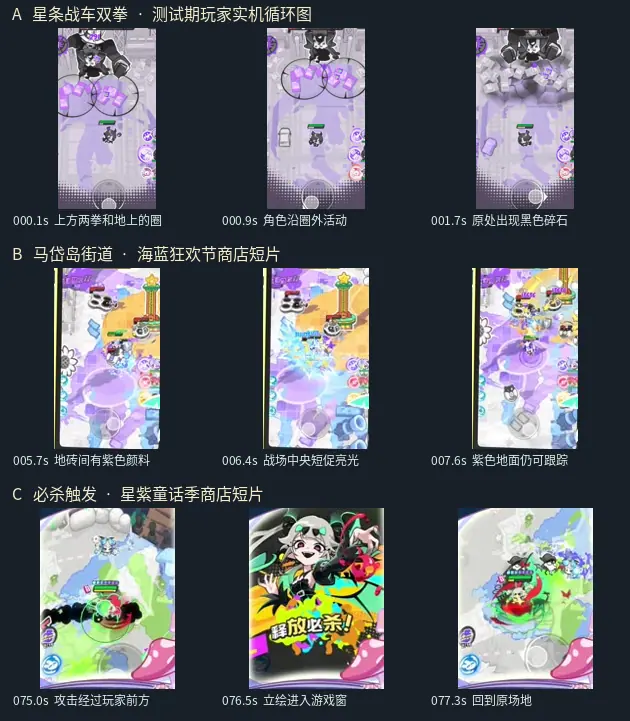

# 《乱涂！彩世界》战斗画面对照

核看日期为 2026 年 11 月 25 日。时间码从每条素材开头计算。下图保留九个低分辨率观察点。两条商店短片都是横版，图中截取了内嵌的竖屏游戏区域。完整前后关系可从原网页回看。

| 来源和版本 | 复查位置 | 连续画面里能看到什么 | 能检验我们哪一处 |
| --- | --- | --- | --- |
| A．Koicc《主线BOSS篇-前两章》，2026-02-26，公测前。星条战车双拳动图，480 × 888，20 帧，每帧 0.1 秒。[图文](https://www.taptap.cn/moment/776073343404084700) · [双拳原动图](https://img2-tc.tapimg.com/moment/etag/lmxWg8GqQwXwZ1-GAtKidQxawai9_20260226115212.gif/_tap_ugc.gif) | 00:00.0–00:01.9 | 上方两只拳头与地上两个描边圆同时可见。角色在两圈下侧移动。最后半秒，原圈附近飞出黑色碎石，角色头顶的绿条仍可找见。 | 对齐预警中心和真正落点，看角色走到哪一侧能躲开。 |
| 同文，三位法老的球体动图。61 帧，每帧 0.1 秒。[图文及原图入口](https://www.taptap.cn/moment/776073343404084700) | 动图题注「左边和中间的法老合力释放球体」下方，00:00.0–00:04.0 | 黑色圆球从上方散开，在黄灰地面上拉开间距。到 3 秒左右，仍能同时看到圆弹、玩家绿条和下方的走位空间。 | 把敌弹轨迹、角色脚下的位置和留在地面的颜色同时摆进一张实战图验收。 |
| Koicc《主线BOSS篇-第四章》，2026-03-01，公测前。题注「召唤小榴莲，玩家可对其进行染色」的连续动图，161 帧，每帧 0.1 秒。[图文及动图入口](https://www.taptap.cn/moment/777108825319672936) | 00:02.0–00:07.5，随后看 00:11.0–00:15.5 | 玩家左右出现两个大圈，之后原处变成深色大物件。到后半段，锯齿状圆物进入场地，黄色地面仍透出原来的地砖线。单看这段画面，无法确定每次染色何时造成伤害。 | 给可交互物、预警和地面涂色三种对象各留一眼能识别的轮廓。 |
| B．TapTap 正式商店的「海蓝狂欢节」短片，含「马岱岛」字样。视频 ID 5718752，34.63 秒。赛季在 2026-06-09 开启。[商店视频](https://www.taptap.cn/app/748842) · [赛季公告](https://www.taptap.cn/moment/813380849582998395) | 00:05.50–00:08.25，同一街角镜头 | 紫色颜料大面跨过地砖边界。右上竖立的设施、目标头顶的红条和蓝白攻击亮光同时可见。亮光散开后，紫色地面保持原状。 | 检查地图形状、落地残色和单次命中亮光能否分辨。 |
| 同一条海蓝狂欢节短片 | 00:08.75–00:11.50，已切到下一镜头 | 黄、紫两条宽颜料带留在地面，黑红爆发和蓝色伤害字出现在敌群中。中央数字亦有叠压。 | 用最挤的一帧验收伤害数字和危险物是否抢位置。 |
| C．TapTap 正式商店的「星紫童话季」短片。视频 ID 6118420，94.20 秒。该赛季于 2026-11-20 开启。[商店视频](https://www.taptap.cn/app/748842) · [赛季说明](https://www.taptap.cn/moment/870365227546312971) | 01:14.5–01:18.3 | 黑色横向攻击掠过角色前方。约 01:16.3–01:16.8，立绘及「释放必杀！」覆盖内嵌竖屏的大部。约 01:17 又能看到原有绿地，接着出现红黑旋转效果。 | 对安可验收三拍。触发前看清玩家位置，弹窗内看清是谁发动，结束后从原地继续读怪。弹窗占屏按本作要求单独验收。 |

以上两个赛季短片含宣传转场。它们能说明同一镜头内各层怎么叠、切回时能看到什么。星紫短片在商店的卡片标题可随赛季更新，复查时同时核对画面文字、视频 ID 和片长。两篇 Boss 攻略中的动图来自玩家，记录了连续短段；角色脚部只占很少像素，录制或转码也可能丢帧。由这些样本无法量出原作的输入延迟、动作原画张数、攻击判定窗口、战斗帧率，也不能据 Boss 攻略推断普通精英的独立行为。
