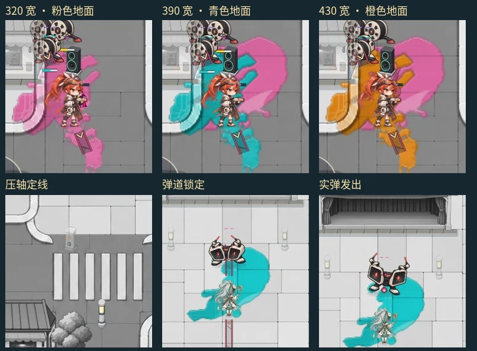
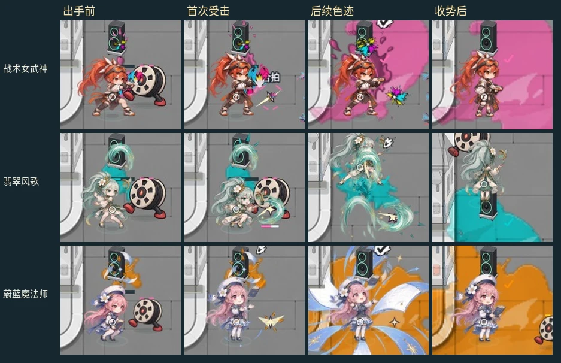
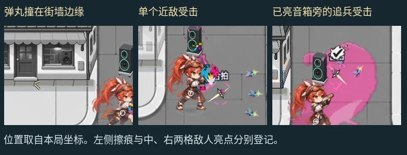
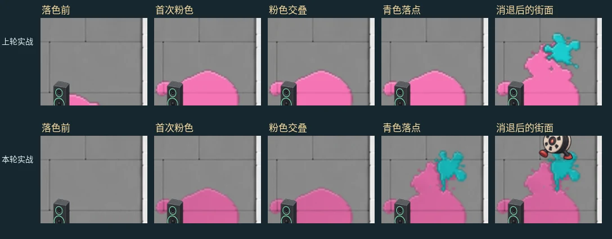
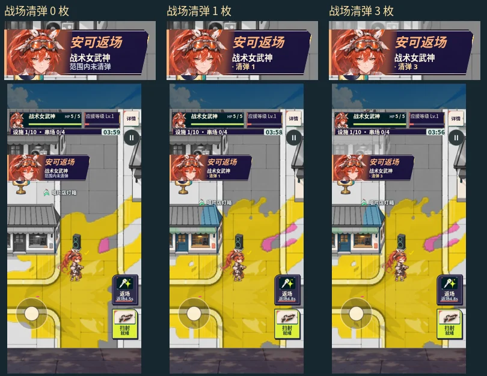

# 战斗画面复查

本轮在同一场战斗里逐项核对下一枪的目标、实际受击者、来弹的方向和颜料最后留下的位置。下表对应上轮现场发现的七个问题。竞品观察集中在《乱涂！彩世界》的公开实战片段。负责人教程 v08 能核对的部分是九格画面，用于区分攻击主体、碰撞亮部与随后散开的碎屑。[上轮差距与原图](../2026-11-25-gap/arena.md) · [竞品片段、原链接和时间码](../2026-11-25-gap/reference.md) · [教程读取记录](../../TUTORIAL_REFERENCE_STATUS.md)

| 场面 | 参考画面与上轮问题 | 本轮成品与检验 |
| --- | --- | --- |
| 自动瞄准与手动集火 | 海蓝狂欢节 5.50–8.25 秒，红色小血条仍能定位敌人。原来音箱指引常驻，转打身边追兵时无人提示。 | 南口音箱旁，同一只追兵距玩家 90 个世界单位时自动瞄准音箱，移到 35 时改瞄追兵。出手前在新目标脚边短暂出现方角或圆弧。手动点音箱后，集火名签移到人物旁边。320、390、430 宽均完成点选和解除，恢复自动后名签消失。 |
| 普通敌人与武器击中 | 实战截屏的撞击亮点落在敌人身上。原红发打倒追兵后，音箱白勾成了附近最醒目的物件。 | 三名成员各用技能按钮攻击。两个真实追兵初始距离分别为 49、200 个世界单位，初始血量均为 36。首次受击时红发和蓝白的近敌血量降至 0，绿发的近敌降至 16。三个场次的远敌均保持 36。两色亮点登记在近敌受击的世界坐标，敌方退场后仍能看到。靠墙窄处可单独画这一点。 |
| 蓝白范围技能 | 星条战车双拳在原有警告圆内落地。上轮蓝白特技只采到零散帧，无法从角色脚下的大橙色墨迹认出侧方受击者。 | 同时摆近、远两敌，固定 60 次/秒推进正式战斗。书页在角色周围展开，右侧近敌另有短促亮部，橙色继续铺在地上。后排敌人保持原血量。下图列出出手前、首次受击、随后 100 毫秒、收势后的原画。 |
| 持久颜料 | 海蓝狂欢节 5.50–8.25 秒可以沿跨砖缝的紫色找到来处。本作上轮重叠颜料的中部接近同一亮度。 | 在同一条砖缝依次落粉色、叠粉色、落青色，再等碎屑消退。落笔方向留下宽窄不同的明暗变化。重叠后的粉、青轮廓可分，路面接缝仍在。150 × 150 世界单位窗口内，结尾保留 1,532 个粉色和 354 个青色栅格样点。原色层与覆盖顺序由正式颜料栅格保存。 |
| 密集队长预警与设施 | 首领双拳的深描边把危险范围与地面颜色分开。原来第一章队长的粉红线在粉墨和人物之间容易断读。 | 在同一南口音箱路口放置 1 名队长与 3 只普通追兵。320 宽铺粉、390 宽铺青、430 宽铺橙，实际危险路径均上色。锁定后的深色带内有浅黄方向箭头。角色身体挡住一段时，箭头从下一段可见地面重新出现。三次均记录到锁定、射出 1 枚弹，以及队长进入收势。近处设施的完成小勾移到空的一肩，双肩都被面部占住时由设备本体换色表示完成。 |
| 压轴首领与实弹 | 攻略法老段落约 0–3 秒，即使黄灰铺地仍能认出黑色弹体。原剧场只拍过空地，攻击线和首次发弹容易混读。 | 在首领与角色之间铺青色，逐帧记录蓄势位置、锁定线与首颗登记的弹。弹体有短尾和明暗外沿，危险线沿冻结的实弹路径绘制。常规敌弹命中半径保持为 7 个世界单位，遇街边遮挡仍用原 4 单位形状判定，折返段的箭头跟随实际弹体折返。 |
| 安可与清弹 | 商店影片约 76.3–77 秒从技能立绘回到原处的旋转攻击。本作侧卡面积已经合适，旧版空放时缺少清弹结果。 | 390 × 844 浏览器先后放入 0、1、3 枚游戏生成的敌弹并点安可。卡上分别显示「范围内未清弹」「清弹 1」「清弹 3」，释放后活弹均为 0。被清弹的位置出现成对短金线。三个案例侧卡占实际画布 6.82%，演出期间战斗继续，中心点击可穿过。 |

另在第一章用真实漆弹撞街墙。枪弹在 (358.4, 1662.0) 一侧销毁，留下两条短擦痕，新增敌人亮点为 0。把追兵放到已亮的南口音箱旁 22 个世界单位再射击，音箱在 (510, 1635)，受击亮点落在追兵 (532, 1635)，该追兵血量归零。

## 身体、路径与证据范围

本轮在 390 宽复跑第五章仓库。普通追兵与玩家被一面墙隔开，起点相距 200 个世界单位。追兵实际横向绕开 119.77，最后靠近到 22.20，寻路保持运行。

发射器、队长和压轴首领在实战取帧中各自经历了蓄势、发弹、收势。干扰者切到压低身体的图格时，设施同步从可用变为受扰，露出的弱点在采样期保持原位。[精英实战连续帧](enemy-live.webp)

普通追兵的卷盘外轮廓、眼睛和脚部一起换了比例。冲前收紧、冲刺伸腿、冲后收脚分别来自攻击状态。受阻且位移为零的追兵切回竖直站姿，守设施有自己的收紧姿势。姿态图是游戏实际采用的美术图格。队长旁三个普通敌人、三位成员与近远敌的画面截自正式第一章战斗。[敌方姿态图格](enemy-poses.webp) · [成员动作](performers.webp) · [上轮寻路与集火现场](../2026-11-25-gap/targeting.md)

取帧均经过桌面 Chromium 的移动视口，未测物理手机 GPU 或触屏延迟。竞技场使用定点生成的真实敌人并推进游戏自己的攻击。三个安可数量另以原速判定。为截下可读文字，只在配图时延长侧卡的确认画面。危险图上排是同一画布局部在三个浏览器尺寸下的裁切，下排为 390 宽的压轴首领。成员图放大近敌一带，远敌的数值取自同次战斗。
