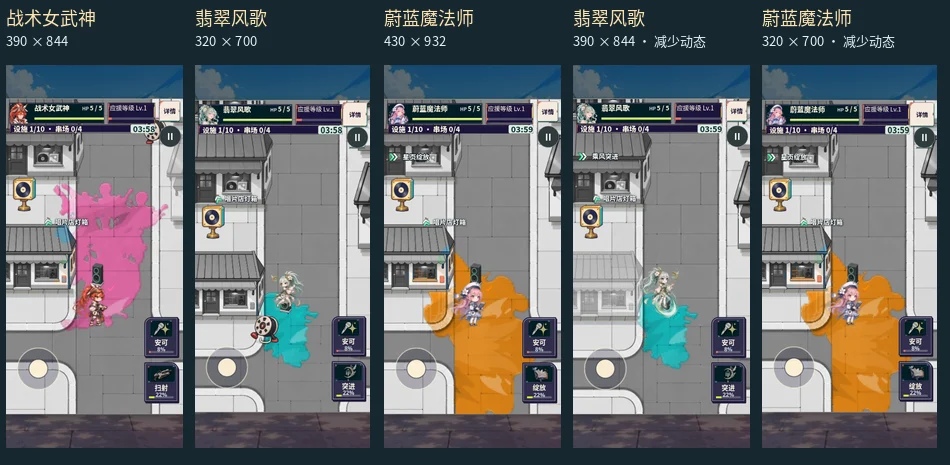

# 正式静态包手机流程复测

本次测试基于游戏源码 `31c4342508f92787391384c8ec00b342e6e67b48`。在 `game/` 运行 `npm run build` 后，通过项目静态服务器从 `dist/` 打开首页。正式包收录 864 项资源，共 155,428,640 字节。五个浏览器会话均使用新存档，从主页点选成员、进入巡演、确认开演，点特技，再打开暂停页里的声音与演出设置，点返回、继续公演。每次均实际等到回合计时再次减少。

| 出战成员 | 手机视口 | 系统减少动态 | 特技发动后 | 恢复前后计时 | 成功响应的不同资源路径 |
| --- | --- | --- | --- | --- | --- |
| 战术女武神 | 390 × 844 | 关闭 | 重新蓄能 | 03:59 → 03:58 | 222 |
| 翡翠风歌 | 320 × 700 | 关闭 | 重新蓄能 | 03:59 → 03:58 | 219 |
| 蔚蓝魔法师 | 430 × 932 | 关闭 | 重新蓄能 | 04:00 → 03:59 | 219 |
| 翡翠风歌 | 390 × 844 | 开启 | 重新蓄能 | 04:00 → 03:59 | 219 |
| 蔚蓝魔法师 | 320 × 700 | 开启 | 重新蓄能 | 04:00 → 03:59 | 219 |

出包校验逐项比对 `public/` 源文件、`dist/` 成品与正式清单的 SHA-256 和文件字节。主游戏、居所及构建生成文件的数量如下。

| 项目 | 数量 |
| --- | --- |
| 主游戏白名单 | 835 |
| 居所白名单 | 29 |
| 已验哈希的全部产物（含入口及打包文件） | 867 |
| 已排除的非发布源文件 | 38 |

每个会话都收到了选中成员的动作图集、敌人姿态图集、第一章唱片地标、颜料地面、落漆和主页导航图片，响应均为 HTTP 200。女武神场次也加载了新的步枪步态。五次均未出现页面异常、控制台错误、HTTP 错误或失败请求。

练习广场两张新图均由正式页面请求，实际解码尺寸为 640 × 604。每个会话分别点击资料库、开演目标，回到广场后再走正常开演流程。各图在窄屏仍有可见高度，演出回合恢复后截图如下。

| 视口宽 | 资料库画面（CSS 像素） | 开演目标画面（CSS 像素） | 卡片跳转 |
| --- | --- | --- | --- |
| 320 | 143 × 112 | 143 × 112 | 两卡均已打开 |
| 390 | 178 × 135 | 178 × 135 | 两卡均已打开 |
| 430 | 198 × 145 | 198 × 145 | 两卡均已打开 |

本次使用 Linux Chromium 的手机触屏模拟与 Canvas 渲染。它能检查静态发布、按钮跳转、资源到达和战斗恢复。物理手机、iOS Safari、WebGL 及长时间战斗帧率须另行测量。
